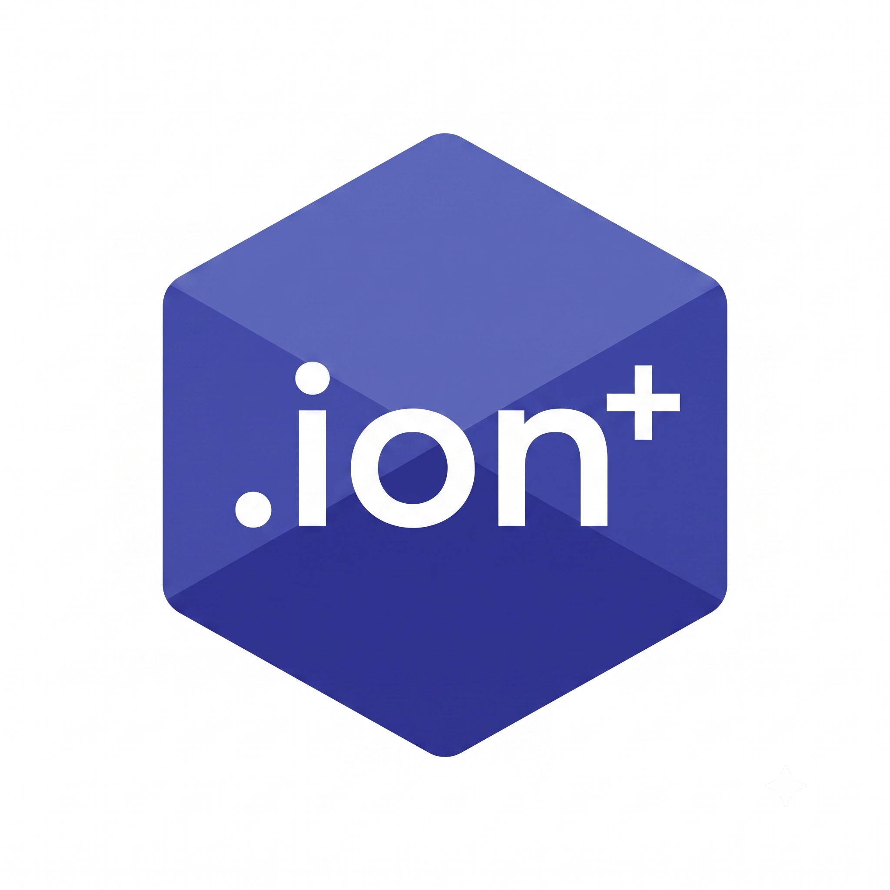
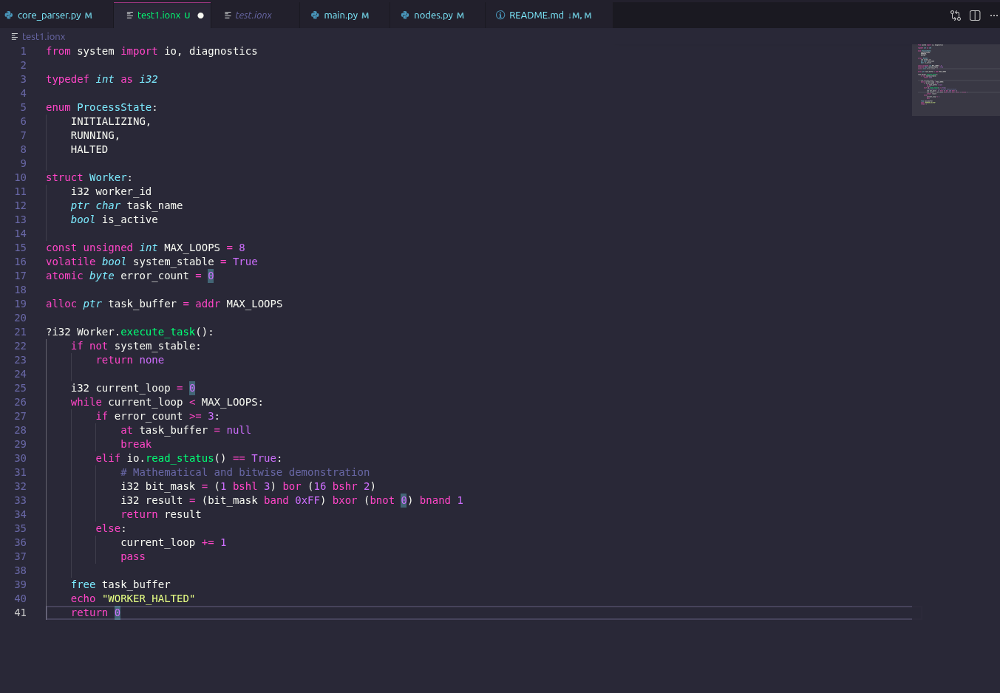

# Ion+

<div align="center">
  
</div>

Ion+ is a small compiler-style project written in Python. The focus is on the frontend of a language: scanning source files, producing tokens, tracking indentation, building a parser, and creating AST-style nodes for later stages such as type checking and code generation.

### Created by: ***Yash Arya***

Website: [ion-plus-preview.onrender.com](https://ion-plus-preview.onrender.com/)  
GitHub: [ion-plus](https://github.com/YashAryaPersonal/ion-plus)  
Discord: [Yash](https://discord.com/users/1551194367627239545)

---

## What Ion+ does

Right now, the project can:

- read `.ionx` source files
- tokenize keywords, operators, literals, and identifiers
- detect indentation and block structure
- parse declarations and basic expressions
- build AST-like structures for future compiler stages

This is still early-stage work, but the direction is clear: a low-level, C-like language with cleaner syntax and a simpler frontend foundation.

---

## Project map

```text
ion-plus/
├── .gitignore
├── .vscode/
├── LICENSE
├── README.md
├── compiler/
│   ├── __init__.py
│   ├── Errors/
│   │   ├── __init__.py
│   │   └── err.py
│   ├── Lexer/
│   │   ├── __init__.py
│   │   ├── post_lexer.py
│   │   ├── scanner.py
│   │   └── tokens.py
│   └── Parser/
│       ├── __init__.py
│       ├── core_parser.py
│       ├── main_parser.py
│       └── nodes.py
├── src/
│   ├── LOGO.png
│   └── screenshot.png
└── test/
    ├── __init__.py
    ├── main.py
    ├── test.ionx
    ├── test1.ionx
    └── test2.ionx
```

### Quick guide

- [compiler](compiler) — core compiler code, lexer, parser, and error utilities
- [compiler/Lexer](compiler/Lexer) — token generation and indentation handling
- [compiler/Errors](compiler/Errors) — compiler error reporting
- [compiler/Parser](compiler/Parser) — parsing logic and AST construction
- [src](src) — project logo and screenshots
- [test](test) — sample source files and runner entry point

---

## How it works

The flow is straightforward:

1. Read a `.ionx` file
2. Scan it into tokens
3. Handle indentation and blocks
4. Parse tokens into AST nodes
5. Prepare the structure for later semantic work

This project is still frontend-focused, but the base architecture is already in place for future compiler features.

---

## Run it

From the project root, run the sample entry point with the project root on the Python path:

```bash
PYTHONPATH=. python test/main.py
```

***Or***, You can also use:

```bash
python -m test.main
```

> Note: running the file directly with `python test/main.py` may fail because the project root is not automatically added to `sys.path` in that execution mode.

### Quick Output

```py
Program(
  line=1, 
  col=0, 
  body=[
    VariableDeclaration(
      line=1, 
      col=16, 
      type=Int(line=1, col=20, is_custom=False), 
      identifier=Identifier(line=1, col=20, value='x'), 
      value=IntegerLiteral(line=1, col=26, value='10'), 
      modifiers=[Const(line=1, col=7), Volatile(line=1, col=16)]
      )
    ], 
  name='test2.ionx'
)
```

This is a representative AST-style example from the early parser work. The project is still evolving, so the exact output depends on the sample file being parsed and the compiler features currently implemented.

---

## Example syntax

This is the kind of syntax the project is aiming for:

```ionx
struct Buffer:
    int size
    ptr byte data

?int Buffer.validate(int max_size):
    if size <= 0 or size >= max_size:
        return none
    return size
```

It is meant to feel like a low-level C-like language, but with a cleaner, more readable syntax.

---

## Current status

Ion+ is still in early development. The lexer and parser are working, and the AST is growing, but there is no full backend or execution engine yet. The project is being built piece by piece.

Parser work is still incomplete, and features such as expression parsing, statement handling, and full language semantics are still being expanded.

---

## Screenshot

<div align="center">
  
</div>

---

## License

This project is under the MIT license. See [LICENSE](LICENSE).

The goal is to learn more about compilers, parsing, and language design while building something practical from scratch. It is still growing, but the base is there.
